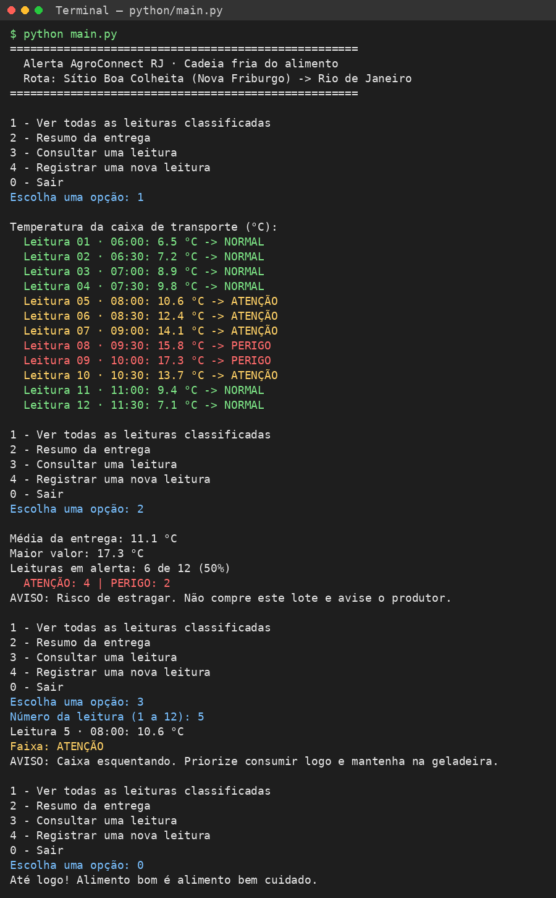

# Lógica · O Cérebro da CitizenTech

Parte de **Computational Thinking with Python** da CitizenTech **AgroConnect RJ**.

## Equipe

| Nome completo | RM |
|---|---|
| Manoel Simião Cavalcante Neto | RM575499 |
| Eric Sia Mapurunga de Aguiar | RM576304 |
| Eduardo Coutinho de Lima | RM575349 |

## O que o programa faz

O programa recebe uma lista de 12 leituras simuladas de um sensor de temperatura colocado dentro da caixa de frutas e verduras que viaja do **Sítio Boa Colheita (Nova Friburgo)** até o consumidor no Rio de Janeiro. Para cada leitura ele decide a faixa (NORMAL, ATENÇÃO ou PERIGO) com `if/elif/else` e mostra o aviso que o cidadão entende: pode comprar, consuma logo, ou não compre este lote. O menu também calcula o resumo da entrega e permite registrar novas leituras.

**Problema que a solução enfrenta:** o alimento fresco do pequeno produtor estraga no caminho do campo até a cidade quando a caixa esquenta demais, e ninguém é avisado.

## Como rodar

1. Instale o Python 3 (o mesmo usado nas aulas).
2. Abra esta pasta no terminal ou no PyCharm.
3. Rode:

```bash
python main.py
```

Não precisa instalar nenhuma biblioteca. O menu só termina quando você digita **0**.

### Opções do menu

| Opção | O que faz |
|---|---|
| 1 | Mostra todas as leituras já classificadas |
| 2 | Mostra o resumo da entrega (média, maior valor, % em alerta) e o aviso final |
| 3 | Consulta uma leitura pelo número e mostra a faixa e o aviso dela |
| 4 | Registra uma nova leitura (hora e temperatura) |
| 0 | Sair |

## De onde vêm os dados

- **Grandeza medida:** temperatura da caixa de transporte, em °C
- **Quantidade de registros:** 12 (de 06:00 a 11:30, uma leitura a cada 30 minutos)
- **Origem:** **simulados pela equipe**, inspirados no produtor fictício "Sítio Boa Colheita" do protótipo AgroConnect RJ (`dados.js` da parte de Web Development). Não são medições reais e não têm dados pessoais.

## Faixas de decisão

Os mesmos limites usados no circuito de Edge e os mesmos textos da página.

| Faixa | Condição | Aviso para o cidadão |
|---|---|---|
| NORMAL | valor < 10 | Alimento bem conservado. Pode comprar e consumir com tranquilidade. |
| ATENÇÃO | 10 ≤ valor < 15 | Caixa esquentando. Priorize consumir logo e mantenha na geladeira. |
| PERIGO | valor ≥ 15 | Risco de estragar. Não compre este lote e avise o produtor. |

Os limites (10 °C e 15 °C) foram definidos pela equipe como referência simples para frutas e verduras frescas. Não são uma norma oficial.

## Resumo calculado

A opção 2 mostra:

- **Média** das temperaturas (soma de todos os valores dividida pela quantidade)
- **Maior valor** registrado na entrega
- **% de leituras em alerta** (conta ATENÇÃO + PERIGO e divide pelo total)
- Quantas leituras ficaram em ATENÇÃO e quantas em PERIGO
- O **aviso final**, que usa a pior faixa que apareceu na entrega

Com os 12 registros simulados: média **11,1 °C**, maior valor **17,3 °C**, **6 de 12 leituras em alerta (50%)** (4 em ATENÇÃO e 2 em PERIGO), então o aviso final é o de PERIGO.

## Integração com as outras partes

| Parte                 | Como conversa com o Python                                  |
| --------------------- | ----------------------------------------------------------- |
| Sensor · Edge         | os registros simulam as leituras do circuito; mesmas faixas |
| Experiência · STXD    | as opções do menu saíram da jornada do cidadão              |
| Interface · Front-end | as mensagens impressas são os textos da página              |
| Interação · Web Dev   | a regra de decisão foi reescrita em JavaScript              |
| Pitch · Storytelling  | o programa rodando aparece no vídeo                         |


## Execução

Print do programa rodando: o menu, a opção 1 (leituras classificadas), a opção 2 (resumo) e a opção 3 (consulta).


